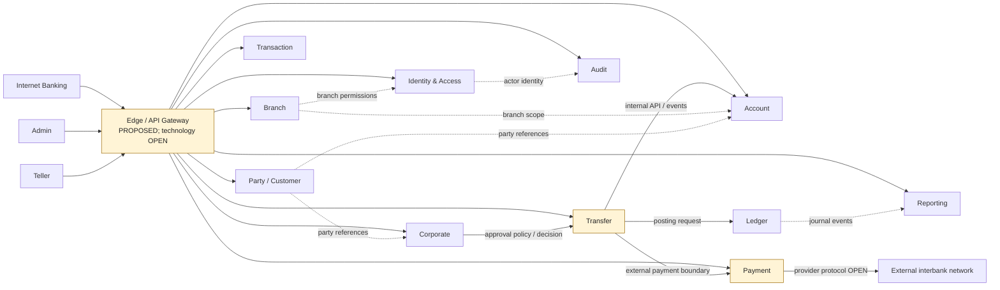
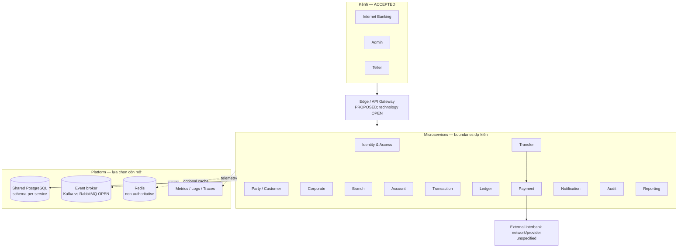
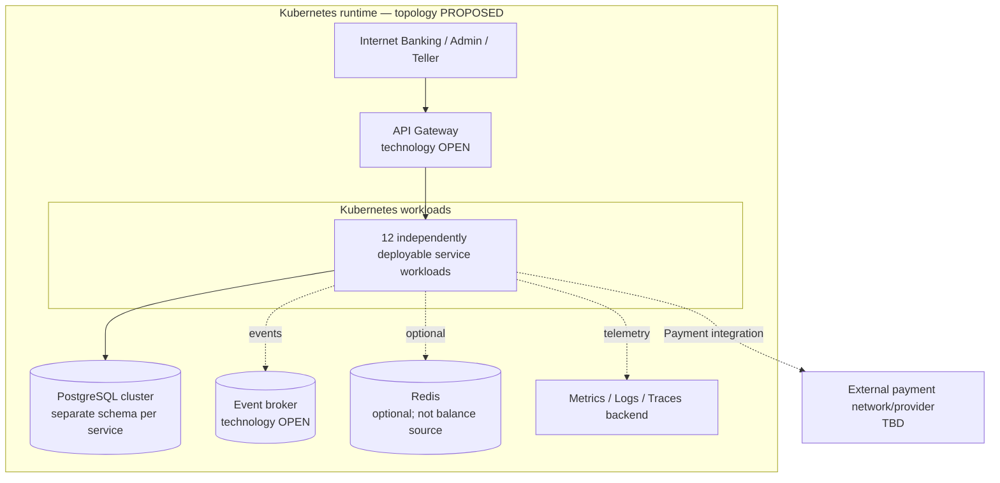

# Banking Clone — Kiến trúc hệ thống

Tài liệu kiến trúc tổng quan. Bounded Contexts, nghiệp vụ, API, event và dữ liệu được đặc tả riêng trong [Bounded Contexts](../domain/BOUNDED_CONTEXTS.md), [Business Rules](../domain/BUSINESS-RULES.md), [API Contracts](../api/API-CONTRACTS.md), [Event Contracts](./EVENT-CONTRACTS.md) và [ERD](../database/ERD.md).

## Trạng thái và mục tiêu

- Dự án đang ở giai đoạn **Architecture Design**; chưa có triển khai nào được xác minh từ source code.
- Phạm vi: Core Banking cho Retail và Corporate Banking, hỗ trợ Internet Banking, Admin và Teller.
- Trạng thái của nội dung: **ACCEPTED** là quyết định chủ dự án xác nhận; **PROPOSED** là thiết kế cần duyệt; **OPEN** là chưa quyết định; **DEFERRED** là để giai đoạn sau.

## Quyết định đã xác nhận

| ADR | Quyết định | Chi tiết |
|---|---|---|
| [ADR-001](../adr/ADR-001-microservices-architecture.md) | ACCEPTED | Microservices Architecture |
| [ADR-002](../adr/ADR-002-retail-corporate-banking.md) | ACCEPTED | Retail + Corporate Banking |
| [ADR-003](../adr/ADR-003-multi-channel.md) | ACCEPTED | Internet Banking, Admin, Teller |
| [ADR-004](../adr/ADR-004-shared-postgresql-schema-per-service.md) | ACCEPTED | PostgreSQL dùng chung, schema riêng theo service |
| [ADR-005](../adr/ADR-005-vnd-only.md) | ACCEPTED | MVP chỉ dùng VND |
| [ADR-006](../adr/ADR-006-internal-and-interbank-transfer.md) | ACCEPTED | Internal + Interbank Transfer |
| [ADR-007](../adr/ADR-007-configurable-corporate-approval.md) | ACCEPTED | Corporate approval có cấu hình |
| [ADR-008](../adr/ADR-008-loan-excluded-from-mvp.md) | ACCEPTED / DEFERRED | Loan ngoài MVP, dự kiến giai đoạn sau |
| [ADR-009](../adr/ADR-009-multi-branch-banking.md) | ACCEPTED | Hỗ trợ nhiều chi nhánh |
| [ADR-010](../adr/ADR-010-phase-1-technical-baseline.md) | ACCEPTED | Java 21, Spring Boot 3, Maven Wrapper, monorepo, Kubernetes local + production, Flyway |

Ngày phê duyệt lịch sử không được cung cấp; xem từng ADR. Công nghệ và chi tiết thiết kế bên dưới không phải quyết định đã chốt trừ khi ghi rõ ACCEPTED.

## Nguyên tắc kiến trúc

- Mỗi service sở hữu dữ liệu và schema của mình. Dùng chung PostgreSQL **không** cho phép truy cập trực tiếp bảng của service khác.
- Không tạo cross-schema foreign key. Service trao đổi định danh và dữ liệu qua API hoặc event.
- Ledger là nguồn dữ liệu chuẩn cho biến động tài chính; chỉ Ledger được ghi journal và posting.
- Debit phải bằng Credit; journal đã posted bất biến, sửa sai bằng reversal.
- Dùng `BigDecimal` trong Java và `NUMERIC` trong PostgreSQL; Redis không phải nguồn chuẩn cho số dư.
- Dùng idempotency, concurrency control và Transactional Outbox cho các luồng tài chính.
- Authorization phải được kiểm tra tại service sở hữu nghiệp vụ và resource, không chỉ ở gateway.
- Phân biệt trạng thái đã xác nhận với đề xuất; không giả định provider, giao thức hay quy tắc settlement chưa được chốt.

## Bounded Contexts / Context Map

Chi tiết ownership, entity, API, event, dependency và giới hạn từng context trong [BOUNDED_CONTEXTS.md](../domain/BOUNDED_CONTEXTS.md).

Các đường nối mô tả quan hệ nghiệp vụ hoặc giao tiếp dự kiến, không phải foreign key. Cơ chế đồng bộ cụ thể giữa một số context là **PROPOSED** và cần review.

## Component Diagram

Gateway, broker, cache usage, deployment topology và các kết nối giữa service là đề xuất; xem [OPEN-DECISIONS.md](./OPEN-DECISIONS.md). PostgreSQL dùng chung và schema-per-service là ACCEPTED.

## Deployment Diagram

Đây là sơ đồ logic. Kubernetes đã được chấp nhận cho local và production; distribution, cluster provider, network zones, replica strategy, availability topology và rollout chi tiết còn OPEN.

## Giao tiếp nội bộ và bên ngoài

- **Channel → service:** REST API là lựa chọn thiết kế hiện tại (**PROPOSED**); gateway technology **OPEN**. Mỗi service vẫn tự xác thực quyền với resource của mình.
- **Service → service:** REST hoặc event là hướng dự kiến. REST vs gRPC và broker Kafka vs RabbitMQ còn **OPEN**.
- **Event contracts:** envelope và payload dự kiến trong [EVENT-CONTRACTS.md](./EVENT-CONTRACTS.md), chưa khẳng định broker đã chọn.
- **External interbank:** Payment là ranh giới tích hợp. Provider, protocol, settlement, retry và reconciliation chưa được xác định; không giả định cụ thể.

## Technology Baseline

| Công nghệ / lựa chọn | Trạng thái |
|---|---|
| Java 21, Spring Boot 3 | ACCEPTED; minor/patch versions not fixed |
| Maven Wrapper | ACCEPTED |
| PostgreSQL dùng chung, schema-per-service | ACCEPTED về topology dữ liệu; phiên bản chưa xác định |
| Flyway | ACCEPTED; migration structure remains service-owned |
| Kafka | PROPOSED; lựa chọn Kafka vs RabbitMQ OPEN |
| Redis | PROPOSED; không phải nguồn chuẩn số dư |
| Kubernetes | ACCEPTED for local development and production orchestration |
| Kubernetes distribution / provider / cluster topology / rollout details | OPEN |
| Spring Security, OAuth2/OIDC, JWT | PROPOSED |
| JUnit 5, Mockito, Testcontainers | PROPOSED |
| Prometheus, Grafana, OpenTelemetry | PROPOSED |
| REST vs gRPC; API Gateway; Identity Provider | OPEN |

## Security Architecture

- OAuth2/OIDC và JWT là **PROPOSED**, chưa chốt Identity Provider.
- Áp dụng RBAC cùng kiểm tra theo organization, account, branch và channel khi nghiệp vụ/resource yêu cầu; chi tiết role/policy là **PROPOSED**.
- Maker–Checker phải được thực thi trong Corporate/approval workflow và được kiểm tra tại service xử lý lệnh, không tin cậy chỉ vào gateway.
- Mỗi service kiểm tra authorization cho resource mà service sở hữu.
- Audit các thao tác nhạy cảm, quyết định duyệt và kết quả financial operation; tránh ghi secret hoặc dữ liệu nhạy cảm không cần thiết.
- Secret management là yêu cầu thiết kế; sản phẩm/cơ chế lưu secret **OPEN**.

## Observability

- **PROPOSED:** metrics, structured logs và distributed traces; OpenTelemetry, Prometheus, Grafana là ứng viên.
- Dùng correlation/causation identifiers xuyên suốt request và event; không ghi credentials, token hoặc dữ liệu thanh toán nhạy cảm vào log.
- Theo dõi trạng thái giao dịch, posting, retry, outbox backlog và external outcome; không dùng telemetry/cache thay dữ liệu nghiệp vụ.
- Retention, alert thresholds, SLOs và backend observability chưa được quyết định.

## Deployment Strategy

- Mỗi bounded context được thiết kế để deploy độc lập (**PROPOSED**, phù hợp ADR-001).
- Kubernetes được ACCEPTED cho local development và production orchestration.
- Kubernetes distribution, local cluster tooling, production provider/topology, HA/DR, scaling, release/rollback và migration coordination còn **OPEN**.
- Mọi thay đổi schema tương lai phải thuộc service sở hữu schema; tài liệu này không tạo hoặc phê duyệt migration.

## Liên kết liên quan

- [Open decisions](./OPEN-DECISIONS.md)
- [ADR index](../adr/README.md)
- [Bounded contexts](../domain/BOUNDED_CONTEXTS.md)
- [Business rules](../domain/BUSINESS-RULES.md)
- [Logical ERD](../database/ERD.md)
- [API contracts](../api/API-CONTRACTS.md)
- [Event contracts](./EVENT-CONTRACTS.md)
