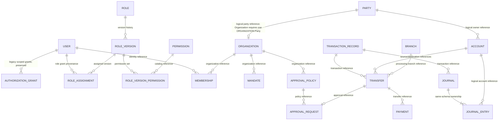

# Logical ERD — Banking Clone

Đây là logical design cho các bounded context; nhiều context còn là **PROPOSED**. Identity Role/Permission Catalog entities marked implemented below are present in migrations V3/V4. Không tạo SQL hoặc migration trong tài liệu này.

## Database boundaries

- **ACCEPTED:** dùng chung một PostgreSQL deployment/cluster.
- **ACCEPTED:** mỗi microservice sở hữu schema riêng.
- Mỗi service chỉ ghi vào schema của mình. Không đọc trực tiếp bảng của service khác.
- **Không tạo cross-schema foreign keys.** Quan hệ liên-service trong diagram là logical references bằng ID, không phải database constraints.
- PostgreSQL version, ID representation, precision/scale cụ thể và migration policy chưa được chốt.

| Service | Schema |
|---|---|
| Identity & Access | `identity_schema` |
| Party / Customer | `party_schema` |
| Corporate | `corporate_schema` |
| Branch | `branch_schema` |
| Account | `account_schema` |
| Transaction | `transaction_schema` |
| Transfer | `transfer_schema` |
| Ledger | `ledger_schema` |
| Payment | `payment_schema` |
| Notification | `notification_schema` |
| Audit | `audit_schema` |
| Reporting | `reporting_schema` |

## Logical relationships

Các connector trong diagram mô tả quan hệ nghiệp vụ/reference. Chỉ quan hệ nằm trong cùng schema mới có thể được cân nhắc làm physical foreign key; cross-schema FK đều bị cấm.

`USER`, `ACCOUNT`, `BRANCH`, `TRANSFER` references in other schemas are IDs only. `JOURNAL` → `JOURNAL_ENTRY` is same-schema; the exact relationship cardinality and account-entry model remain subject to Ledger design review.

Identity tables shown above are implemented by migrations V1-V4. `authorization_grant` retains legacy user/permission/scope tuples; Role-derived grants are resolved from each `role_assignment` and are not materialized into that table. Duplicate effective tuples are deduplicated at read time, so revoking one assignment does not discard a tuple supported by another active assignment. Corporate Membership and Mandate remain Corporate-owned and are not replaced by Identity Roles.

## Entity and constraint proposal

All IDs below are opaque identifiers; UUID is a **PROPOSED** implementation choice, not an accepted decision. Constraint and index names are illustrative.

| Schema / table | Core columns and key rules (PROPOSED) | Suggested indexes |
|---|---|---|
| `identity_schema.user_identity` (implemented) | `user_id` PK; `issuer`, `subject`; UNIQUE `(issuer, subject)`; status `ACTIVE`/`DISABLED`; optional logical `party_id` reference (no FK) | `(status)` |
| `identity_schema.authorization_grant` (implemented) | PK `(user_id, permission, scope_type, scope_id)`; scope values `SELF`, `ORGANIZATION`, `BRANCH`; no source or validity tracking yet | `(user_id)` |
| `identity_schema.identity_audit` (implemented) | `audit_id` PK; actor/action/resource/result/time/correlation ID; current use includes principal-resolution audit | `(actor, occurred_at)`, `(resource_type, resource_id, occurred_at)` |
| `identity_schema.permission_catalog` (implemented) | `permission_code` PK; lifecycle status `ACTIVE`/`PENDING_IMPLEMENTATION`/`RESTRICTED`; description and creation time | PK |
| `identity_schema.role_catalog` (implemented) | Stable `role_code` PK; display name, category, description, `ACTIVE`/`INACTIVE` status | PK |
| `identity_schema.role_version` (implemented) | `role_version_id` PK; role FK; version; `DRAFT`/`PUBLISHED`; creation/publication actor and time; published versions immutable | UNIQUE `(role_code, version)` |
| `identity_schema.role_version_permission` (implemented) | Composite PK `(role_version_id, permission_code)`; FKs to Role Version and Permission; mapping immutable after publication | Permission lookup index |
| `identity_schema.role_assignment` (implemented) | `assignment_id` PK; `user_id`; published Role Version; scope `SELF`/`ORGANIZATION`/`BRANCH`; `scope_id`; `ACTIVE`/`REVOKED`; `assigned_by`, effective/expiry and revocation fields | `(user_id, status, valid_from, expires_at)` |
| `party_schema.party` | `party_id` PK; `party_type`; `status`; optional logical `managing_branch_id` reference (no FK); created timestamps | `(party_type, status)`, `(managing_branch_id, status)` |
| `party_schema.individual_profile` | `party_id` PK and same-schema FK to `party`; profile fields subject to PII design | PII searches only if approved |
| `corporate_schema.organization` | `organization_id` PK; required `party_id` UNIQUE logical reference to exactly one Party of type `ORGANIZATION`; `status` | `(status)` |
| `corporate_schema.membership` | `membership_id` PK; `organization_id`; exact authenticated `subject`; role code/status; no cross-schema FK | UNIQUE one active membership per organization/subject/role; `(organization_id, subject, role_code, status)` |
| `corporate_schema.mandate` | `mandate_id` PK; `membership_id` same-schema FK; mandate scope/status | UNIQUE one active mandate per membership/scope; `(membership_id, mandate_scope, status)` |
| `corporate_schema.approval_policy` | `policy_id` PK; `organization_id`; opaque `operation_type`; immutable policy version/content; status and explicit activation timestamp; requests pin this version (ADR-007) | UNIQUE `(organization_id, operation_type, policy_version)`; partial UNIQUE for one active version per organization/operation type |
| `corporate_schema.approval_policy_level` | `policy_level_id` PK; `policy_id` same-schema FK; ordered `step_number`; required `role_code` and `mandate_scope`; runtime role cannot update/delete levels | UNIQUE `(policy_id, step_number)` |
| `corporate_schema.approval_request` | `approval_request_id` PK; `organization_id`; opaque owner-supplied `operation_type` / `operation_reference`; `maker_subject`; composite FK binds policy version to the same organization and operation type; status; no cross-schema FK | `(organization_id, submitted_at)`, `(operation_type, operation_reference)` |
| `corporate_schema.approval_step` | `approval_step_id` PK; `approval_request_id` same-schema FK; ordered step; required role/mandate scope; deciding actor reference; decision/time | UNIQUE `(approval_request_id, step_number)` |
| `corporate_schema.approval_history` | `history_id` PK; composite same-schema FK binds `approval_request_id` to its pinned `policy_id`; actor, step, decision, timestamp, correlation ID; append-only | `(approval_request_id, occurred_at)`, `(actor, occurred_at)` |
| `branch_schema.branch` | `branch_id` PK; branch code unique without case sensitivity; name/status; created/updated timestamps | `(status, name, branch_id)` |
| `account_schema.account` | `account_id` PK; `account_number` UNIQUE; logical `party_id` reference; account type/status; `currency` constrained to VND in MVP | `(party_id, status)` |
| `account_schema.account_status_history` | `history_id` PK; `account_id` same-schema FK; status/reason/actor/time | `(account_id, changed_at)` |
| `transaction_schema.financial_transaction` | `transaction_id` PK; operation type/status; idempotency scope/key; correlation refs | Idempotency follows actor + operation + business scope and 24-hour default when used; exact scope/storage per API remain to be designed; `(status, created_at)` |
| `transaction_schema.transaction_status_history` | `history_id` PK; `transaction_id` same-schema FK; from/to status, time, reason | `(transaction_id, changed_at)` |
| `transfer_schema.transfer` | `transfer_id` PK; `transaction_id`, source/destination account IDs, processing branch ID refs; amount `NUMERIC`; currency VND; transfer type/status | UNIQUE idempotency reference if owned here; `(source_account_id, created_at)`, `(status, created_at)`, `(transaction_id)` |
| `ledger_schema.journal` | `journal_id` PK; `transaction_id` reference; status, posted time; `reversal_of_journal_id` same-schema self-reference; posted record immutable | UNIQUE posting idempotency key; `(transaction_id)`, `(posted_at)` |
| `ledger_schema.journal_entry` | `entry_id` PK; `journal_id` same-schema FK; `account_id` ref; side Debit/Credit; `amount NUMERIC`; currency VND | `(journal_id)`, `(account_id, journal_id)` |
| `payment_schema.payment` | `payment_id` PK; `transfer_id` reference; provider/network reference nullable; submission/outcome status and timestamps | UNIQUE provider reference when present; `(transfer_id)`, `(status, updated_at)` |
| `notification_schema.notification` | `notification_id` PK; recipient reference; template/channel/status; no secrets | `(status, created_at)` |
| `notification_schema.delivery_attempt` | `attempt_id` PK; `notification_id` same-schema FK; attempt status/time | `(notification_id, attempted_at)` |
| `audit_schema.audit_record` | `audit_record_id` PK; actor/resource/action/result/correlation/time; append-only | `(resource_type, resource_id, recorded_at)`, `(actor_id, recorded_at)` |
| `reporting_schema.*` | Projection tables keyed by source IDs/version; source is event stream/domain owners | indexes per report access pattern; no source write |

### Key constraints and unresolved details

- Monetary values use PostgreSQL `NUMERIC`; precision/scale and rounding policy are **OPEN**. Reject binary floating-point inputs.
- Journal entries must be positive monetary amounts with an explicit Debit/Credit side; Ledger validates total Debit = total Credit before atomic posting.
- When a command uses idempotency, scope it by actor, operation and business scope; default retention is 24 hours. Same key/same payload replays the prior result; same key/different payload conflicts. Each operation's exact business scope and storage remain to be designed; do not assume globally unique client keys or a shared table. See [ADR-012](../adr/ADR-012-phase-2-identity-party-corporate-branch.md).
- Account numbers, branch codes, policy versions and external references have uniqueness scope to be confirmed.
- A customer has one primary managing branch at a time; it is a single logical reference distinct from transaction-processing branch. Whether assignment is required at customer creation and reassignment workflow/effective-date rules remain to be defined. See [ADR-012](../adr/ADR-012-phase-2-identity-party-corporate-branch.md).
- Each Corporate Organization maps 1:1 to one Party of type `ORGANIZATION` through a logical reference; there is no cross-schema FK. Organization legal-identity fields and jurisdiction-specific uniqueness remain OPEN.
- The first `branch_schema` migration implements branch code/name/status and case-insensitive code uniqueness; status transition and lifecycle operations remain OPEN.
- Corporate V1 implements `organization` with a unique logical `party_id` and an organization audit table. Corporate validates the Party type through the Party owner API. V2 implements approval-policy administration and creates the request, step and append-only decision-history tables. V3 implements 24-hour decision idempotency. V4 implements Corporate-owned Membership and Mandate records; decisions require active matching records through `JdbcApproverEligibilityClient`.
- Party duplicate detection uses soft match and human review. Do not add default uniqueness on National ID, phone or email, or auto-merge/delete candidates. Matching fields and thresholds remain OPEN.
- External destination data and provider identifiers are not modeled beyond references until interbank provider/protocol are known.
- Do not add FK between schemas even if all schemas reside in one PostgreSQL database.
- The Transfer first slice owns `transfer_schema.transfers`, `transfer_schema.transfer_idempotency`, and `transfer_schema.transfer_audit`. Approval request and policy references are opaque cross-context IDs with no Foreign Key or direct read into Corporate tables.

## Ownership and access

- Schema owner service has write permission to its schema. Other services get no direct table grants.
- A service obtains cross-context data through owner API or its own event-built projection.
- Read-only Reporting projections do not become authoritative financial data.
- Ledger remains authoritative; Redis/caches may not be used as source of truth for balances.

Xem [Bounded Contexts](../domain/BOUNDED_CONTEXTS.md), [Business Rules](../domain/BUSINESS-RULES.md) và [Open Decisions](../architecture/OPEN-DECISIONS.md).
