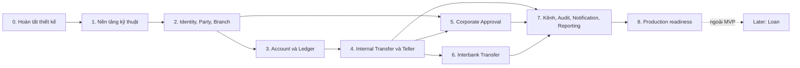

# Banking Clone — Lộ trình triển khai đề xuất

Lộ trình dưới đây chia dự án thành các giai đoạn có thể kiểm chứng, từ thiết kế đến MVP và mở rộng. Đây là **đề xuất về thứ tự triển khai**, không thay đổi ADR đã được chấp nhận và không tự bổ sung business requirement. Dự án hiện được ghi nhận ở giai đoạn **Architecture Design**; chưa xác minh có implementation.

## Nguyên tắc chia giai đoạn

- Mỗi phase cần hoàn thành tiêu chí đầu ra trước khi mở rộng sang luồng phụ thuộc.
- Các lựa chọn công nghệ/API/schema chi tiết còn **PROPOSED** hoặc **OPEN** phải được chủ dự án duyệt trước khi triển khai tương ứng.
- Từng service sở hữu schema riêng; không truy cập trực tiếp bảng của service khác.
- Luồng tài chính phải tuân thủ Ledger, double-entry, idempotency, concurrency control, transaction atomicity và outbox.
- Không đưa Loan vào MVP. Chi tiết trạng thái và open decisions xem [Architecture](../architecture/BANKING_ARCHITECTURE.md), [Business Rules](../domain/BUSINESS-RULES.md) và [Open Decisions](../architecture/OPEN-DECISIONS.md).

## Tổng quan

| Phase | Tên | Mục tiêu / kết quả chính | Điều kiện hoàn tất |
|---|---|---|---|
| 0 | Hoàn tất thiết kế | Chốt contract, mô hình và các quyết định cần thiết cho MVP | Domain/API/event/ERD được review; không còn OPEN chặn luồng sắp triển khai |
| 1 | Nền tảng kỹ thuật | Chuẩn hóa service, database ownership, bảo mật, CI và observability | Service mẫu chạy được; schema isolation và kiểm tra tự động được chứng minh |
| 2 | Danh tính và dữ liệu chủ | Identity, Party/Customer, Corporate cơ bản và Branch | Tạo/tra cứu party, organization, user và branch theo quyền |
| 3 | Account và Ledger | Mở tài khoản thanh toán; journal, posting, reversal và balance query | Ledger posting atomic, cân bằng, bất biến và idempotent |
| 4 | Giao dịch nội bộ và Teller | Retail internal transfer; teller deposit/withdrawal | Luồng end-to-end không ghi balance ngoài Ledger và chống giao dịch trùng |
| 5 | Corporate Banking | Membership, mandate, approval policy nhiều cấp và Maker–Checker | Corporate transfer chờ/duyệt/thi hành theo policy đã chốt, có history |
| 6 | Interbank Transfer | Kết nối external network qua Payment | Provider/protocol và settlement/reconciliation rules được duyệt; xử lý unknown outcome |
| 7 | Kênh và vận hành nghiệp vụ | Internet Banking, Admin, Notification, Audit, Reporting | Kênh kiểm tra quyền theo resource/org/branch/channel; truy vết và báo cáo đúng phạm vi |
| 8 | Production readiness | Kiểm thử, bảo mật, tải, phục hồi và triển khai | Các tiêu chí release, vận hành, rollback và giám sát được duyệt và kiểm chứng |
| Later | Loan | Mở rộng sau MVP | Có business requirements và kế hoạch/ADR riêng |

## Chi tiết từng phase

### Phase 0 — Hoàn tất thiết kế và quyết định MVP

**Trạng thái hiện tại theo tài liệu:** Architecture Design.

- Review [Bounded Contexts](../domain/BOUNDED_CONTEXTS.md), [ERD](../database/ERD.md), [API Contracts](../api/API-CONTRACTS.md), [Event Contracts](../architecture/EVENT-CONTRACTS.md) và [Business Rules](../domain/BUSINESS-RULES.md).
- Xác nhận các API/event cần cho luồng MVP, ownership của status và vị trí idempotency record.
- Làm rõ transaction limits, business-day rules, approval policy snapshot, managing-branch cardinality và interbank settlement nếu các mục này chặn luồng định triển khai.
- Duyệt lựa chọn kỹ thuật cần cho giai đoạn nền tảng: Identity Provider, gateway, broker, internal communication và rollout. Không cần chốt lựa chọn không ảnh hưởng phase hiện tại.

**Hoàn tất khi:** các contract cho phase kế tiếp nhất quán; không biến đề xuất thành yêu cầu; các quyết định chặn được ghi nhận và duyệt.

### Phase 1 — Nền tảng kỹ thuật

Kế hoạch triển khai chi tiết: [Phase 1 — Technical Foundation](./phase/Phase-1-Technical-Foundation.md).

- Tạo cấu trúc service, quy ước cấu hình, logging, health checks và correlation IDs.
- Thiết lập PostgreSQL dùng chung với schema-per-service, quyền ghi riêng và nguyên tắc không cross-schema FK/table access.
- Thiết lập pipeline build/test và môi trường phát triển sau khi công nghệ tương ứng được duyệt.
- Tạo skeleton cho Transactional Outbox, consumer idempotency, error handling và telemetry theo lựa chọn đã duyệt.

**Hoàn tất khi:** một service mẫu có thể build/test/run; chứng minh được schema ownership, migration boundary theo service và telemetry cơ bản. Chưa triển khai nghiệp vụ tài chính.

### Phase 2 — Identity, Party, Corporate cơ bản và Branch

- Xây dựng authentication/authorization theo Identity Provider đã được chọn; identity không sở hữu tài khoản tiền gửi.
- Tạo và quản lý Party/Customer cá nhân, doanh nghiệp.
- Tạo Organization, membership và mandate tối thiểu cần cho corporate authorization.
- Quản lý Branch; phân biệt managing branch với transaction processing branch.
- Ghi audit cho thao tác nhạy cảm ngay từ các luồng đầu tiên.

**Hoàn tất khi:** onboarding customer/organization và branch scope có thể kiểm thử; quyền user, organization và Teller/branch không dựa duy nhất vào API Gateway.

### Phase 3 — Account và Ledger

- Mở tài khoản thanh toán VND; không tự thêm Savings hoặc Loan Account.
- Account quản lý vòng đời và trạng thái, không trực tiếp ghi sổ kế toán.
- Ledger triển khai journal double-entry, posting atomic, immutable posted entries và reversal.
- Thiết kế truy vấn số dư từ Ledger hoặc read model được xác định rõ là non-authoritative; không dùng Redis làm nguồn chuẩn.

**Hoàn tất khi:** kiểm thử chứng minh Debit = Credit, không thể sửa journal đã posted, reversal tạo bút toán đối ứng, retry không tạo posting trùng và xử lý đồng thời không double-spend.

### Phase 4 — Retail Internal Transfer và Teller

- Triển khai internal transfer qua Transfer orchestration và Ledger posting.
- Hỗ trợ luồng Teller Deposit/Withdrawal theo cùng nguyên tắc: không cập nhật balance trực tiếp.
- Áp dụng idempotency, concurrency control, transaction status và audit trail.
- Tách rõ trạng thái accepted, processing, settled, failed theo semantics đã được duyệt.

**Hoàn tất khi:** test end-to-end bao phủ thành công, validation thất bại, retry cùng key, key/payload conflict và concurrent requests; số liệu tài chính khớp Ledger.

### Phase 5 — Corporate approval và Corporate Transfer

- Hoàn thiện configurable approval policy, nhiều cấp duyệt, Maker–Checker và approval history.
- Triển khai policy version/snapshot theo quyết định chủ dự án; không tự chọn hành vi khi policy đổi lúc giao dịch đang chờ.
- Áp dụng organization-level authorization và ràng buộc membership/mandate cho corporate transfer.

**Hoàn tất khi:** test chứng minh maker không tự checker, thiếu quyền không thể duyệt, approval history đầy đủ, duplicate decision an toàn và chỉ giao dịch đã đạt yêu cầu approval mới được thực thi.

### Phase 6 — Interbank Transfer

- Chỉ bắt đầu tích hợp khi external network/provider, protocol và security requirements được chọn.
- Hoàn thiện Payment adapter boundary, mapping trạng thái và xử lý callback/query theo contract thực tế.
- Chốt posting timing, timeout, settlement, reversal và reconciliation trước khi đưa vào vận hành.
- Biểu diễn outcome chưa xác định; không đánh dấu thất bại hoặc reversal chỉ do timeout.

**Hoàn tất khi:** sandbox/contract tests chứng minh được submission, duplicate/retry, delayed response, unknown outcome, reconciliation và các recovery cases theo quy tắc đã duyệt.

### Phase 7 — Kênh, Audit, Notification và Reporting

- Hoàn thiện Internet Banking, Admin và Teller theo scope được xác nhận.
- Thực thi channel-, organization-, account- và branch-level authorization trong service sở hữu resource.
- Hoàn thiện Audit trail, notification delivery và Reporting projections.
- Đảm bảo báo cáo không trở thành nguồn chuẩn thay Ledger; giới hạn dữ liệu theo quyền caller.

**Hoàn tất khi:** kiểm thử quyền trên từng kênh và scope; sự kiện được xử lý idempotent; notification/report không làm thay đổi trạng thái tài chính.

### Phase 8 — Production readiness

- Chạy unit, integration, contract, end-to-end, concurrency và load tests theo tiêu chí được duyệt.
- Thực hiện threat/security review, secret management, kiểm tra audit và rà soát dữ liệu nhạy cảm trong log.
- Định nghĩa SLO, alert, backup/restore, disaster recovery, rollout/rollback và runbook.
- Kiểm tra outbox backlog, retry/dead-letter, reconciliation và khả năng phục hồi sau lỗi.

**Hoàn tất khi:** các tiêu chí phát hành và vận hành được chủ dự án duyệt; test/diễn tập chứng minh khả năng phục hồi; không còn lỗi nghiêm trọng chưa xử lý.

### Later — Loan

Loan nằm ngoài MVP và được để dành cho giai đoạn sau. Trước khi thực hiện cần business requirements, bounded context/domain model và ADR riêng; không đưa Loan vào Account/transfer MVP như một giả định.

## Phụ thuộc chính

Sơ đồ thể hiện thứ tự phụ thuộc đề xuất, không phải timeline hay phân công nhân lực. Một số phần có thể làm song song sau khi dependency và contract liên quan được duyệt.

## Ngoài phạm vi MVP

- Loan.
- FX hoặc tiền tệ khác ngoài VND.
- Business rules chưa được xác nhận như hạn mức, cutoff, phí, loại tài khoản bổ sung hoặc settlement behavior cụ thể.
- Bất kỳ provider, protocol, API Gateway, Identity Provider hay broker cụ thể nào trước khi được duyệt.

## Tài liệu tham chiếu

- [Architecture overview](../architecture/BANKING_ARCHITECTURE.md)
- [Open decisions](../architecture/OPEN-DECISIONS.md)
- [Bounded contexts](../domain/BOUNDED_CONTEXTS.md)
- [Business rules](../domain/BUSINESS-RULES.md)
- [Logical ERD](../database/ERD.md)
- [API contracts](../api/API-CONTRACTS.md)
- [Event contracts](../architecture/EVENT-CONTRACTS.md)
