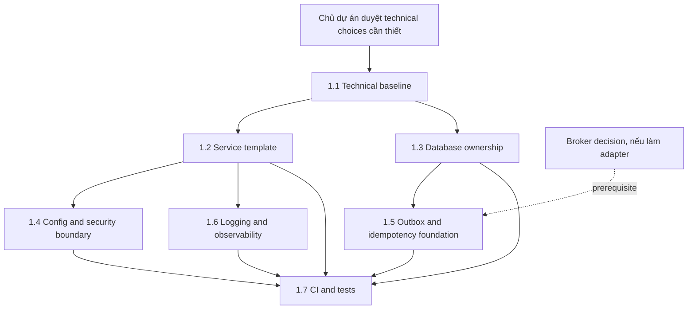

# Phase 1 — Technical Foundation

## Mục tiêu

Thiết lập nền tảng kỹ thuật có thể lặp lại cho các microservice tiếp theo: service template, schema ownership, cấu hình, kiểm thử tự động và khả năng vận hành cơ bản.

Đây là **implementation plan**. Các lựa chọn ACCEPTED được ghi trong ADR; lựa chọn PROPOSED/OPEN vẫn cần duyệt trước công việc phụ thuộc. Plan này không tự cho phép bắt đầu code ngoài phạm vi đã được phê duyệt.

## Trạng thái nền

- Dự án đang ở Phase 1 — Technical Foundation; service template tối thiểu đã được tạo, chưa có banking domain implementation.
- **ACCEPTED:** microservices; PostgreSQL dùng chung với schema-per-service.
- **ACCEPTED:** Java 21, Spring Boot 3, Maven Wrapper, monorepo với thư mục service độc lập, Kubernetes cho local và production, và Flyway cho migration thuộc sở hữu từng service. Xem [ADR-010](../../adr/ADR-010-phase-1-technical-baseline.md).
- **PROPOSED:** JUnit 5, Mockito, Prometheus, Grafana và OpenTelemetry là định hướng chung.
- **ACCEPTED riêng cho local development và kiểm thử nền tảng:** PostgreSQL 17.12 trong Minikube và Testcontainers để tương thích với Flyway do Spring Boot quản lý; không quyết định PostgreSQL production hoặc chính sách test cho các service sau.
- **ACCEPTED theo ADR-011:** local development dùng Ubuntu 24.04, Docker, Minikube, Kubernetes Secret và Spring Boot environment variables. Production theo hướng external store + External Secrets Operator + IAM/RBAC; EKS/Kubernetes provider và Secrets Manager/Vault cụ thể còn OPEN.
- **OPEN:** PostgreSQL major version production, production Kubernetes provider/topology/rollout details, broker, API Gateway, Identity Provider, REST vs gRPC và một số chi tiết observability.
- Phase này không được tự biến PROPOSED/OPEN thành quyết định đã chốt. Xem [Architecture](../../architecture/BANKING_ARCHITECTURE.md) và [Open Decisions](../../architecture/OPEN-DECISIONS.md).

## Phạm vi

### Bao gồm

- Chốt tối thiểu các công nghệ và quy ước cần thiết để tạo service đầu tiên.
- Thiết lập skeleton cho một service mẫu, không chứa nghiệp vụ ngân hàng.
- Quy định service chỉ sở hữu và ghi vào schema của mình.
- Thiết lập cấu hình theo môi trường, logging, health checks và correlation ID.
- Thiết lập pipeline build/test và kiểm tra tự động.
- Thiết kế/kiểm chứng điểm mở rộng cho Transactional Outbox và consumer idempotency; publisher/broker cụ thể chỉ làm sau khi chọn broker.
- Thiết lập nền tảng telemetry theo lựa chọn được duyệt.

### Không bao gồm

- Triển khai bất kỳ bounded context hoặc nghiệp vụ banking nào.
- Triển khai Kubernetes cluster/manifests hoặc production rollout trong mục 1.1; cần scope work item và chọn distribution/topology trước khi thực hiện.
- Authentication/authorization hoàn chỉnh; phase này chỉ chuẩn bị điểm tích hợp an toàn nếu cần.
- Database migration nghiệp vụ hoặc tạo schema cho toàn bộ service.
- Loan, transfer, account, ledger, customer, branch hay payment feature.
- Production deployment, HA/DR hoặc cam kết SLO.

## Các quyết định cần duyệt trước khi bắt đầu

| Quyết định | Trạng thái hiện tại | Điều kiện cần để tiếp tục |
|---|---|---|
| Java 21 và Spring Boot 3 | ACCEPTED | Minor/patch version và dependency policy cần chốt khi tạo service template |
| Maven Wrapper | ACCEPTED | Pin wrapper và xác định dependency policy |
| Monorepo, thư mục độc lập theo service | ACCEPTED | Tên thư mục/build module strategy cần chốt khi tạo template |
| PostgreSQL production major version | OPEN | Chọn version được hỗ trợ; PostgreSQL 17.12 chỉ được chọn cho local development và kiểm thử nền tảng |
| Migration tool | Flyway ACCEPTED | Migration files vẫn phải thuộc service; chưa có migration nào được duyệt |
| Broker | Kafka vs RabbitMQ OPEN | Chỉ cần chốt trước khi triển khai publisher/consumer adapter |
| Kubernetes cho local và production | ACCEPTED | Local: Minikube; production provider, topology và rollout details OPEN |
| Secret delivery | ADR-011 ACCEPTED | Local: Kubernetes Secret qua environment variables; production: External Secrets Operator + IAM/RBAC, nhưng provider/store cụ thể OPEN |
| Security / Identity Provider | OAuth2/OIDC/JWT PROPOSED; provider OPEN | Phase 1 chỉ tạo integration boundary; không tự triển khai identity provider |
| Observability stack | Prometheus/Grafana/OpenTelemetry PROPOSED | Chốt tối thiểu định dạng/collector/metrics cần để kiểm chứng |

Không nhất thiết phải chốt mọi quyết định tương lai trong Phase 1. Mỗi lựa chọn chỉ cần được duyệt trước khi công việc phụ thuộc vào nó.

## Kế hoạch công việc

### 1.1 — Chốt technical baseline

Technical baseline đã được chủ dự án duyệt và ghi tại [ADR-010](../../adr/ADR-010-phase-1-technical-baseline.md).

- Lập quyết định ngắn cho Java/framework, build tool, repository layout và môi trường chạy local.
- Ghi rõ version policy, dependency update policy, cấu hình profile và cách quản lý secrets.
- Phân loại phần nào là cần thiết cho service mẫu và phần nào để phase sau.

**Trạng thái:** Hoàn tất. Các lựa chọn còn mở được liệt kê ở trên và trong [Open Decisions](../../architecture/OPEN-DECISIONS.md).

### 1.2 — Tạo service template tối thiểu

- Tạo một service mẫu với cấu trúc source, cấu hình, entry point và quy ước lỗi/log thống nhất.
- Có endpoint health/liveness và readiness phù hợp runtime đã chọn.
- Nhận/gán correlation ID cho request và truyền tiếp qua log/context.
- Không thêm domain entity, API nghiệp vụ hoặc dữ liệu giả mang ý nghĩa nghiệp vụ.
- Nếu chưa chốt API Gateway, mẫu phải chạy được độc lập trong local environment mà không phụ thuộc gateway.

**Đầu ra:** service mẫu build và khởi động được; cấu hình thiếu/sai được báo lỗi rõ ràng, không fallback thành cấu hình thành công giả.

**Trạng thái:** Đã triển khai service template, correlation ID, health probes, container image và Kubernetes local manifest. Build/test và container smoke test thành công. Chưa apply manifest vì Kubernetes context chưa được cấu hình.

### 1.3 — Thiết lập database ownership

- Tạo cách cấp schema/role riêng cho service mẫu trên shared PostgreSQL.
- Quyền của service chỉ cho phép ghi schema sở hữu; không cấp quyền đọc/ghi bảng của service khác.
- Không tạo cross-schema foreign key hoặc shared application tables.
- Giới hạn Flyway migration location/history/user vào service sở hữu; migration chỉ chạy explicit trong test/local workflow.
- Tạo kiểm thử hoặc kiểm tra tự động chứng minh ranh giới quyền; không chỉ dựa vào quy ước tài liệu.

**Đầu ra:** kiểm chứng được quyền đúng/sai trên schema; không tạo migration nghiệp vụ hoặc schema cho các service chưa triển khai.

**Trạng thái:** Hoàn tất cho service template. Bootstrap SQL tạo migration/runtime roles và schema riêng; Flyway chỉ chạy explicit bằng migration role. PostgreSQL 17.12/Testcontainers integration tests xác nhận quyền runtime, quyền migration, Flyway history trong schema sở hữu và không có cross-schema foreign keys. Cấu hình kết nối runtime được triển khai ở mục 1.4; chưa có migration nghiệp vụ hoặc production provisioning.

### 1.4 — Cấu hình, secrets và security boundary

- Dùng cấu hình environment variables cho local và Kubernetes workloads; local secret source theo [ADR-011](../../adr/ADR-011-phase-based-secret-management.md).
- Production dùng external secret store qua External Secrets Operator; EKS/Kubernetes provider và AWS Secrets Manager/Vault cụ thể vẫn OPEN.
- Không commit secret; không log secret, credential hoặc token.
- Mặc định không mở endpoint nghiệp vụ chưa được bảo vệ.
- Tạo interface/điểm tích hợp authentication nếu cần, nhưng không giả lập Identity Provider như production.
- Ghi rõ khi nào cần quyết định Identity Provider trước Phase 2.

**Đầu ra:** service khởi động với cấu hình được cung cấp; thiếu cấu hình bắt buộc thì fail fast; secrets không xuất hiện trong repository/log/test output.

**Trạng thái:** Hoàn tất cho service template/local development. PostgreSQL URL, username và password được đọc từ environment variables; password local được cấp qua Kubernetes Secret. Thiếu biến bắt buộc làm ứng dụng fail fast; readiness kiểm tra kết nối database. Test xác nhận cấu hình được kiểm tra và giá trị nhạy cảm bị redacted khỏi `toString`; production secret-store integration và provider cụ thể vẫn OPEN.

### 1.5 — Reliability foundations

- Thiết kế boundary và schema pattern cho Transactional Outbox trong schema sở hữu của service.
- Đảm bảo ghi domain change và outbox record cùng local database transaction khi có nghiệp vụ ở các phase sau.
- Xác định consumer idempotency pattern, deduplication key và transaction boundary.
- Sau khi broker được duyệt, tạo proof-of-concept publisher/consumer chỉ để kiểm chứng delivery, retry và deduplication; không phát event nghiệp vụ thật.
- Chưa chốt retry limit, backoff, dead-letter implementation hay ordering policy nếu chưa có decision phù hợp.

**Đầu ra:** tài liệu/pattern và test chứng minh tính nguyên tử trong database; broker adapter chỉ được làm sau khi công nghệ được duyệt. Không cần chạy broker cho service mẫu nếu chưa có quyết định.

**Trạng thái:** Hoàn tất cho database foundation của service template. Pattern gồm `outbox_event` và `processed_event` trong schema sở hữu của service; test xác nhận commit/rollback cùng transaction, unique deduplication marker cho consumer và không tạo cross-service FK. Broker adapter và quyết định delivery/retry/dead-letter vẫn chưa triển khai.

### 1.6 — Logging và observability

- Chuẩn hóa structured logs với timestamp, service name, severity và correlation ID.
- Chọn cách thu thập metrics/traces theo stack được duyệt; không gắn PII, secret hay token vào telemetry.
- Có health/readiness signal và metric tối thiểu để biết service hoạt động.
- Chưa đặt SLO, alert threshold, retention hoặc production dashboard nếu chưa được thống nhất.

**Đầu ra:** local/test environment có thể quan sát startup, request và lỗi cơ bản mà không làm lộ dữ liệu nhạy cảm.

**Trạng thái:** Hoàn tất foundation cho service template. Log console là structured JSON; request log có service name, correlation ID, method, path, status và elapsed time; MDC được cleanup sau request. Micrometer expose `/actuator/metrics` và `/actuator/prometheus` làm local metrics foundation. Backend Prometheus/Grafana/OpenTelemetry production, trace exporter, retention, SLO và alert thresholds vẫn OPEN.

### 1.7 — CI và kiểm thử nền tảng

- Tự động build, chạy unit tests, static checks và kiểm tra cấu hình/migration theo công cụ được duyệt.
- Thêm integration test cho PostgreSQL/schema permissions; Testcontainers chỉ dùng nếu dependency được chấp thuận.
- Kiểm tra health endpoint, correlation ID, fail-fast config và không log secret.
- Đảm bảo pipeline thất bại rõ ràng khi kiểm tra bắt buộc thất bại.

**Đầu ra:** một lệnh CI chuẩn có thể tái lập; kết quả test là điều kiện merge theo quy trình được duyệt.

## Thứ tự và phụ thuộc

Broker adapter là nhánh có điều kiện; phần database outbox pattern và các contract có thể được thiết kế độc lập. Không tự chọn broker để bỏ qua prerequisite.

## Tiêu chí hoàn tất Phase 1

- [ ] Technical choices cần cho service mẫu đã được chủ dự án duyệt; đề xuất chưa được duyệt được ghi rõ và chưa triển khai.
- [ ] Service mẫu build/run/test lặp lại được theo hướng dẫn.
- [x] Database owner của service mẫu chỉ có quyền phù hợp trên schema của mình; không cross-schema table access/FK.
- [x] Cấu hình bắt buộc được validate; secrets không có trong source hoặc logs.
- [x] Health/readiness và correlation ID hoạt động trong local/test.
- [x] Structured logs và local metrics foundation hoạt động trong local/test; production observability backend và policy vẫn OPEN.
- [ ] CI chạy build, unit/static checks và integration checks cần thiết; lỗi được hiển thị rõ.
- [x] Outbox/consumer idempotency pattern được kiểm thử hoặc các giới hạn phụ thuộc broker được ghi nhận.
- [x] Không có banking feature hoặc migration nghiệp vụ được thêm trong phase nền tảng.
- [x] Tài liệu nền tảng và quyết định phát sinh được cập nhật, link và trạng thái nhất quán.

## Rủi ro và cách kiểm soát

| Rủi ro | Cách kiểm soát |
|---|---|
| Đóng băng sớm công nghệ chưa được duyệt | Ghi status PROPOSED/OPEN; yêu cầu approval trước task phụ thuộc |
| Dùng chung DB dẫn tới service đọc bảng của nhau | Tạo DB role/schema isolation và kiểm thử quyền thật |
| Service template phình thành framework nội bộ | Chỉ thêm cấu phần cần thiết cho acceptance criteria; không tạo abstraction tổng quát chưa có use case |
| Chọn broker/deployment chỉ để hoàn thành demo | Tách các nhánh có điều kiện; không tự suy diễn quyết định |
| Secrets hoặc dữ liệu nhạy cảm lọt vào logs | Redaction policy và kiểm thử log/telemetry |
| Outbox pattern được thêm nhưng semantics delivery không rõ | Không tuyên bố exactly-once; ghi rõ delivery/retry assumptions sau khi broker được duyệt |

## Ngoài phạm vi và đầu vào cho Phase 2

Phase 1 kết thúc ở nền tảng; không đồng nghĩa đã có Identity, Party, Corporate hay Branch service.

Đầu vào Phase 2:

- Service template và database ownership pattern được kiểm chứng.
- Authentication/authorization integration path đủ rõ để thiết kế Identity.
- Quyết định Identity Provider được duyệt trước khi triển khai authentication.
- Logging, correlation ID, CI và môi trường phát triển sẵn sàng cho các service nghiệp vụ đầu tiên.

## Tài liệu liên quan

- [Lộ trình các phase](../Phases.md)
- [Architecture overview](../../architecture/BANKING_ARCHITECTURE.md)
- [Open decisions](../../architecture/OPEN-DECISIONS.md)
- [Bounded contexts](../../domain/BOUNDED_CONTEXTS.md)
- [Logical ERD](../../database/ERD.md)
