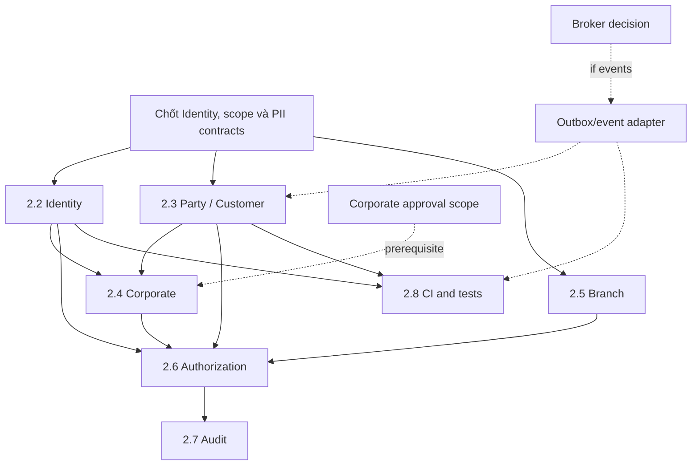

# Phase 2 — Identity, Party, Corporate and Branch

## Mục tiêu

Triển khai các bounded context nền cho danh tính và dữ liệu chủ: Identity & Access, Party / Customer, Corporate và Branch.

Đây là **implementation plan**. Các lựa chọn ACCEPTED được ghi trong ADR; lựa chọn PROPOSED/OPEN vẫn cần duyệt trước công việc phụ thuộc. Plan này không tự biến quyết định mở thành yêu cầu đã chốt.

## Trạng thái nền

- Phase 1 đã hoàn tất: service template, schema-per-service, Flyway, cấu hình/secrets, correlation ID, health probes, observability foundation và CI đều đã được kiểm chứng.
- **ACCEPTED:** Java 21, Spring Boot 3, Maven Wrapper, monorepo, Kubernetes, PostgreSQL shared deployment và schema-per-service.
- **ACCEPTED:** Retail + Corporate banking, VND-only, multi-channel, multi-branch và configurable Corporate approval.
- **ACCEPTED:** managing branch và transaction processing branch là hai khái niệm riêng; Teller bị giới hạn bởi branch permission.
- **ACCEPTED theo ADR-012:** Keycloak/OIDC, REST synchronous cho first slice, RBAC + scoped grants + owner-side authorization, customer có một primary managing branch tại một thời điểm, Organization:Party 1:1 logical reference, PII soft-match/human review, idempotency policy và audit baseline.
- **OPEN:** API Gateway, broker/event transport, full role/permission catalog, PII fields/matching thresholds, branch reassignment workflow, operation-specific idempotency scope, audit storage/retention enforcement, approval thresholds, detailed role/mandate catalog/API and exact claim mapping, and production compliance details.
- Phase 2 không triển khai Account, Ledger, Transfer, Payment hoặc Loan.

Các nền tảng liên quan: [ADR-002](../../adr/ADR-002-retail-corporate-banking.md), [ADR-003](../../adr/ADR-003-multi-channel.md), [ADR-009](../../adr/ADR-009-multi-branch-banking.md), [ADR-010](../../adr/ADR-010-phase-1-technical-baseline.md), [Open Decisions](../../architecture/OPEN-DECISIONS.md).

## Phạm vi

### Bao gồm

- Tích hợp qua Keycloak/OIDC đã được duyệt; Keycloak owns login, password management và token issuance.
- Thực hiện identity subject mapping, active/inactive lifecycle, RBAC và scoped grants.
- Tạo Party/Customer cho cá nhân và dữ liệu customer tối thiểu được duyệt.
- Tạo Organization, membership, mandate và approval policy cơ sở cho Corporate.
- Tạo Branch và branch status; áp dụng branch scope cho user/organization/account references ở phase sau.
- Thêm authorization checks tại service sở hữu resource, không dựa duy nhất vào API Gateway.
- Lưu audit trail cho thao tác nhạy cảm, membership/mandate/branch changes và identity lifecycle.
- Thiết kế API, migration, idempotency và test cho từng bounded context.
- Cập nhật ERD, API contracts, event contracts và architecture decisions phát sinh.

### Không bao gồm

- Custom credential storage hoặc token issuer giả lập Identity Provider.
- Account, balance, Ledger journal hoặc financial posting.
- Retail transfer, teller deposit/withdrawal hoặc interbank integration.
- Transfer-level approval enforcement/execution chưa thuộc Phase 2; Corporate Approval core behavior đã được chốt trong ADR-007, còn Membership/Mandate integration và exact claim mapping là prerequisites.
- Notification, Reporting, production Gateway hoặc production cluster rollout.
- Loan.

## Các quyết định cần duyệt trước khi bắt đầu

| Quyết định | Trạng thái | Điều kiện cần để tiếp tục |
|---|---|---|
| Identity Provider và grant/flow | ACCEPTED — ADR-012 | Keycloak/OIDC; Authorization Code + PKCE cho interactive users, Client Credentials cho service identities; token issuance/password do Keycloak sở hữu |
| Principal mapping và authorization boundary | ACCEPTED — ADR-012 | Unique `(issuer, subject)` mapping; optional `partyId`; RBAC + `SELF`/`ORGANIZATION`/`BRANCH` scoped grants; owner-side authorization |
| API Gateway | OPEN | Chỉ cần trước khi triển khai public Internet Banking/Admin routing |
| REST vs gRPC cho synchronous internal API | ACCEPTED — ADR-012 | REST cho synchronous commands/queries trong first slice; gRPC không nằm trong slice này |
| Customer managing-branch cardinality | ACCEPTED — ADR-012 | Một primary branch tại một thời điểm; reassignment phải explicit/audited; workflow còn OPEN |
| Organization và Party relationship | ACCEPTED — ADR-012 | Corporate-owned Organization 1:1 tới Party loại `ORGANIZATION`, logical reference; legal-identity uniqueness còn OPEN |
| PII duplicate policy | ACCEPTED — ADR-012 | Soft match/human review; không mặc định unique National ID/phone/email, không auto-merge/delete; fields/thresholds còn OPEN |
| Role, permission và scope model | ACCEPTED baseline — ADR-012 | RBAC + scoped grants + resource-level checks; full roles, permissions and inheritance remain OPEN |
| Idempotency | ACCEPTED baseline — ADR-012 | Actor + operation + business scope, default retention 24h; per-operation scope/format/storage remain to be defined |
| Audit policy | ACCEPTED baseline — ADR-012 | Required actor/action/resource/result/time/correlation; 7-year project baseline subject to legal review; storage/access design OPEN |
| Approval policy version behavior | ACCEPTED — ADR-007 | Immutable policy version lúc submit; explicit activation; role/mandate scope; exact catalog/claims remain OPEN |

Không triển khai phần phụ thuộc vào quyết định OPEN trước khi quyết định đó được chủ dự án duyệt.

## Kế hoạch công việc

### 2.1 — Chốt contract và domain gate

- Xác nhận boundary: Identity không sở hữu customer/account/balance; Party không sở hữu organization credentials; Corporate không ghi Ledger.
- Chốt entities, API, event và uniqueness rules cho service đầu tiên.
- Chốt scope tối thiểu của actor/principal: validated user ID, optional Party reference, grants, organization, branch và channel.
- Cập nhật logical schema/ERD contracts cho `identity_schema`, `party_schema`, `corporate_schema`, `branch_schema`; không tạo migrations trong work item 2.1.
- Ghi nhận synthetic/test identities, không dùng credential/tài khoản thật trong test.

**Đầu ra:** ADR và contract baseline cho Identity Provider, authorization, idempotency, audit, branch cardinality, Party/Organization mapping và synchronous API protocol.

**Bản phê duyệt:** [ADR-012](../../adr/ADR-012-phase-2-identity-party-corporate-branch.md) ghi nhận 9/9 quyết định đã được chủ dự án duyệt. Contract updates và các giới hạn OPEN của first slice được theo dõi trong [Phase 2 Decision Gate](./Phase-2-Decision-Gate.md).

**Trạng thái:** Hoàn tất decision baseline và cập nhật contract-level docs cho các quyết định được duyệt. Các OPEN item vẫn chặn migration/implementation cụ thể nếu ảnh hưởng tới schema, security boundary hoặc API.

### 2.2 — Identity & Access

- Tạo service hoặc module độc lập theo cấu trúc service template; tích hợp Keycloak/OIDC.
- Tạo migration riêng trong `identity_schema`; không thêm bảng shared hay cross-schema FK.
- Map validated `(issuer, subject)` duy nhất tới local opaque `userId`; Keycloak remains owner of authentication/token issuance.
- Chốt user lifecycle states và đồng bộ/disable behavior với Keycloak trước migration; các trạng thái cụ thể hiện còn OPEN.
- Triển khai role và scoped grant entities; kiểm tra organization/branch/account scope ở resource owner.
- Cung cấp identity principal resolution cho API; token issuance luôn thuộc Keycloak, không tự phát token nội bộ.
- Ghi audit cho identity lifecycle, role/grant thay đổi và authentication result theo policy.

**Đầu ra:** identity subject và scoped authorization có thể kiểm thử; không lưu hoặc log secret/token.

**Trạng thái:** Chưa bắt đầu.

### 2.3 — Party / Customer

- Tạo migration và service trong `party_schema`.
- Triển khai `Party`, `IndividualProfile` và chỉ các profile fields đã được duyệt cho retail/customer.
- Phân biệt individual và organization/corporate party; không nhân đôi organization data trong Party.
- Thêm create/read/update API theo resource authorization.
- Dùng optimistic version cho update; không cho lost-update silently.
- Áp dụng soft-match duplicate candidates với human review; không tự merge/xóa hoặc tạo mặc định National ID/phone/email uniqueness.
- Dùng create idempotency nếu contract yêu cầu; theo actor + operation + business scope, retention mặc định 24h.
- Publish `PartyCreated` sau khi event transport/broker được duyệt; trước đó có thể triển khai contract và outbox pattern.

**Đầu ra:** customer/party lifecycle tối thiểu, PII được giới hạn và audit/log không lộ dữ liệu nhạy cảm.

**Trạng thái:** First slice đã triển khai trong `party-service`; soft-match fields/thresholds, owner-side scoped-grant resolution với Identity, và `PartyCreated` broker/outbox vẫn còn OPEN.

### 2.4 — Corporate

- Tạo migration trong `corporate_schema`.
- Triển khai Organization mapped 1:1 tới một Party loại `ORGANIZATION` bằng logical `partyId`, không dùng cross-schema FK.
- Triển khai Membership, Mandate, ApprovalPolicy và approval history.
- Kiểm tra organization membership và mandate trong Corporate, không tin caller-supplied role.
- Enforce Maker–Checker khi xử lý approval action; không cho maker tự duyệt nếu rule được duyệt.
- Ghi policy version và approval history đủ để audit.
- Áp dụng immutable policy version đã được duyệt trong ADR-007; không triển khai Transfer-level approval enforcement/execution trong Phase 2.

**Đầu ra:** corporate onboarding và approval eligibility có thể kiểm thử; không thực hiện transfer hoặc Ledger posting.

**Trạng thái:** Organization first slice đã triển khai trong `corporate-service`: tạo/đọc Organization, xác thực Party type qua owner API và giữ unique logical `partyId`. Approval V2 đã thêm policy schema, policy administration (create/list/activate), scoped permission và audit; request/decision workflow, Membership, Mandate và decision-history writes vẫn chưa triển khai. Canonical Keycloak claim mapping và Membership/Mandate owner interfaces còn là prerequisites cho workflow.

Kế hoạch chi tiết cho Corporate Approval core (policy đa cấp, Maker–Checker và approval history; không bao gồm Transfer/Ledger execution) nằm tại [Corporate Approval implementation plan](./corporate-approval/plan.md). Membership/Mandate implementations hoặc owner interfaces đã duyệt, cùng các decision gate được liệt kê trong plan, là prerequisites trước khi triển khai workflow.

### 2.5 — Branch

- Tạo migration trong `branch_schema`.
- Triển khai branch code/name/status và branch lifecycle tối thiểu được duyệt.
- Phân biệt managing branch với transaction processing branch ở contract/reference.
- Áp dụng branch visibility/permission theo Identity principal tại service sở hữu resource.
- Customer có một primary managing branch tại một thời điểm; phân biệt với transaction-processing branch. Reassignment explicit và phải audit; workflow/effective date còn OPEN.
- Không đưa Teller credential hay financial transaction vào Branch schema.

**Đầu ra:** branch scope và status có thể dùng làm reference bởi Party/Account/Transfer ở phase sau.

**Trạng thái:** First slice đã triển khai trong `branch-service` (create/read/list, `branch_schema`, case-insensitive unique code và scoped branch-read visibility). Identity/Keycloak claim mapping và status lifecycle transitions vẫn còn OPEN.

### 2.6 — Authorization và tích hợp cross-service

- Áp dụng owner-side authorization ở Identity/Party/Corporate/Branch.
- Cung cấp principal context từ Identity Provider; không tin role/organization/branch trong request body.
- Dùng API hoặc event/outbox cho cross-context reference; broker adapter chỉ khi broker đã được duyệt.
- Forward correlation ID qua synchronous call hoặc event.
- Tránh cross-service direct table access và cross-schema FK.
- Kiểm tra failure boundary: caller không báo success nếu synchronous/durable audit contract bắt buộc thất bại.

**Đầu ra:** authorization và correlation hoạt động nhất quán qua các service Phase 2.

**Trạng thái:** Chưa bắt đầu.

### 2.7 — Audit foundation

- Mở rộng audit contract cho identity/party/corporate/branch sensitive actions.
- Ghi tối thiểu actor, action, resource type/ID, result, correlation ID và timestamp; organization/channel/branch khi áp dụng.
- Áp dụng project retention baseline bảy năm subject to legal/compliance review trước production.
- Redact secret/token/credential/PII không cần thiết.
- Tách synchronous durable audit cho thao tác bắt buộc khỏi optional notification/audit event.
- Test append-only behavior và denied audit access theo permission được duyệt.

**Đầu ra:** audit records chứng minh actor/action/resource/result và không chứa secret.

**Trạng thái:** Chưa bắt đầu.

### 2.8 — CI và kiểm thử Phase 2

- Mỗi service build bằng Maven độc lập nhưng chạy trong CI monorepo.
- Chạy unit, contract và PostgreSQL/Testcontainers integration tests.
- Chứng minh mỗi service role chỉ DML/DDL trong schema sở hữu.
- Chứng minh không có cross-schema FK/direct table access.
- Test duplicate create, stale update, forbidden scope, membership/mandate, Maker–Checker và audit.
- Chạy configuration validation/fail-fast, structured-log secret scan và health checks.
- Thất bại CI rõ ràng khi migration/permission/contract acceptance bị vi phạm.

**Đầu ra:** một lệnh verify lặp lại cho từng service và pipeline aggregate theo quy trình được duyệt.

**Trạng thái:** Chưa bắt đầu.

## Thứ tự và phụ thuộc

Không chọn API Gateway, broker, Identity Provider hoặc internal protocol chỉ để hoàn thành demo.

## Kiểm thử bắt buộc

- Identity: external subject mapping, inactive/locked identity, role grant, stale/replayed token behavior theo provider.
- Party: create duplicate/retry, optimistic stale update, PII redaction và organization/branch visibility.
- Corporate: organization membership, duplicate membership, mandate scope, Maker–Checker, conflicting approval replay.
- Branch: unique code, branch status transition, branch visibility và managing/processing branch distinction.
- Cross-service: correlation ID, no cross-schema FK/table access, idempotency conflict và failed audit handling.
- Configuration: required variables fail startup; secret value không xuất hiện trong source/log/test output.
- CI: migration và permission tests phải chạy tự động; thất bại là điều kiện merge.

## Tiêu chí hoàn tất Phase 2

- [ ] Identity Provider và authorization boundary đã được duyệt; không triển khai custom credential/token issuer chưa được chấp thuận.
- [ ] Identity subject mapping, role và scoped grant hoạt động và được test.
- [ ] Party/Customer API và migration thuộc `party_schema`; PII và audit được giới hạn.
- [ ] Organization, membership, mandate và approval policy cơ sở thuộc `corporate_schema`.
- [ ] Maker–Checker và organization/mandate authorization được kiểm thử.
- [ ] Branch data thuộc `branch_schema`; managing/processing branch được phân biệt.
- [ ] Không có cross-schema table access, cross-schema FK hoặc shared domain table.
- [ ] Mỗi sensitive action có durable audit contract phù hợp và không log secret/token/PII không cần thiết.
- [ ] API và event contracts liên quan đã được review và tài liệu trạng thái nhất quán.
- [ ] CI chạy build/test/permission/migration checks cho các service Phase 2.
- [ ] Không thêm Account, Ledger, Transfer, Payment hoặc Loan implementation.

## Rủi ro và cách kiểm soát

| Rủi ro | Cách kiểm soát |
|---|---|
| Chọn sai Identity Provider hoặc tự phát credential | Chốt provider/flows trước implement; chỉ tích hợp qua principal boundary |
| PII lộ qua API, log hoặc telemetry | Data minimization, redaction tests và retention/access policy |
| Organization/branch authorization chỉ nằm ở Gateway | Enforce owner-side authorization trong Identity/Party/Corporate/Branch |
| Party và Organization bị trùng ownership | Party quản lý person/profile, Corporate quản lý organization/membership/mandate |
| Corporate approval bị thực thi trong service sai | Approval eligibility/decision thuộc Corporate; execution/context chỉ ở transfer phase sau |
| Approval behavior bị suy đoán | Tuân thủ ADR-007 cho lifecycle/snapshot/rejection/sequencing; chặn tích hợp khi Membership/Mandate APIs hoặc claim mapping chưa sẵn sàng |
| Cross-service coupling qua direct DB | Schema roles, integration tests và API/event-only references |
| Phase 2 mở rộng thành Account/Ledger | Giữ scope gate và chặn migration/API cho bounded context chưa được approved |

## Ngoài phạm vi và đầu vào cho Phase 3

Phase 2 kết thúc ở Identity, Party/Customer, Corporate và Branch. Không đồng nghĩa đã có Account hoặc Ledger.

Đầu vào Phase 3:

- Identity principal và scoped authorization đã hoạt động.
- Party và Organization mapping đã được duyệt.
- Branch identity và permission model đã sẵn sàng.
- Audit contract có thể ghi actor/resource/action/result.
- Account có thể reference Party/Organization/Branch bằng logical IDs.
- Ledger integration chỉ bắt đầu sau khi account, double-entry và balance rules được duyệt.

## Tài liệu liên quan

- [Lộ trình các phase](../Phases.md)
- [Architecture overview](../../architecture/BANKING_ARCHITECTURE.md)
- [Bounded contexts](../../domain/BOUNDED_CONTEXTS.md)
- [Logical ERD](../../database/ERD.md)
- [API contracts](../../api/API-CONTRACTS.md)
- [Event contracts](../../architecture/EVENT-CONTRACTS.md)
- [Business rules](../../domain/BUSINESS-RULES.md)
- [Open decisions](../../architecture/OPEN-DECISIONS.md)
